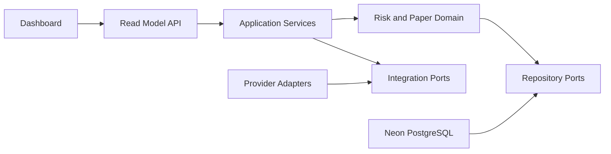

# Architecture Spine — Vikoagent

## Design Paradigm

Modular layered architecture:

```text
providers -> adapters -> application services -> domain engine -> persistence
                                          \-> read model API -> dashboard
```

Provider-specific code enters through adapters. Domain rules remain deterministic and provider-independent.

## Invariants & Rules

### AD-1 — Explicit module ownership

- **Binds:** all capabilities
- **Prevents:** frontend, API, worker, and domain modules implementing conflicting ownership rules
- **Rule:** Keep UI, API/read model, ingestion, domain engine, persistence, and configuration as separate boundaries with one-direction dependencies.

### AD-2 — Domain owns state transitions

- **Binds:** CAP-2, CAP-4
- **Prevents:** LLM, UI, or feed adapters mutating trade state independently
- **Rule:** Risk engine owns decision transitions and paper portfolio mutations; callers submit commands and consume results.

### AD-3 — Database is system record

- **Binds:** CAP-1, CAP-2, CAP-4
- **Prevents:** multiple authoritative token, decision, trade, or portfolio stores
- **Rule:** Neon PostgreSQL is source of truth. Every external event and command uses an idempotency key before persistence.

### AD-4 — Adapter isolation

- **Binds:** CAP-1, CAP-3, CAP-4
- **Prevents:** PumpPortal, OpenRouter, Solana RPC, or Meteora APIs leaking into domain rules
- **Rule:** Integrations implement ports owned by application/domain layers; domain imports no provider SDK.

### AD-5 — Devnet/Paper safety boundary

- **Binds:** all capabilities
- **Prevents:** accidental mainnet or real-fund execution during Phase 1
- **Rule:** Runtime starts in `SOLANA_NETWORK=devnet` and `AGENT_MODE=PAPER`; startup rejects mainnet configuration and unsafe live-mode configuration.

### AD-6 — LLM explanation boundary

- **Binds:** CAP-3
- **Prevents:** generated text approving, signing, or directly executing trades
- **Rule:** LLM receives sanitized market context and returns explanation text only. Risk engine remains authoritative. Signing credentials stay backend-only.

### AD-7 — Stable read model boundary

- **Binds:** CAP-5
- **Prevents:** browser coupling to database schema or external feed payloads
- **Rule:** Dashboard consumes versioned API read models and one replaceable live-update transport abstraction; frontend never connects directly to DB or providers.

### AD-8 — Dependency direction

- **Binds:** all capabilities
- **Prevents:** circular dependencies and provider-driven domain design
- **Rule:**



## Consistency Conventions

| Concern | Convention |
|---|---|
| Naming | TypeScript modules use kebab-case folders; domain actions use explicit verbs; event IDs and mint addresses remain strings. |
| Data & formats | ISO 8601 UTC timestamps; decimal financial values use exact database numeric representation; API errors use stable `code`, `message`, and `requestId`. |
| State & cross-cutting | Commands mutate through application services; events are append-only; logs include request/event IDs; config validates network and mode at startup. |
| Idempotency | Provider event identity or composed source key required for ingestion and execution writes. |
| Security | Secrets load server-side only; no private key, API key, or raw provider credential enters browser payloads or LLM prompts. |

## Stack Seed

| Name | Version |
|---|---|
| Node.js | 24 Active LTS |
| Next.js | 16.4.x |
| Solana JavaScript SDK | v3 / `@solana/kit` |
| Neon driver | `@neondatabase/serverless` |
| Database | Neon PostgreSQL |
| Network | Solana Devnet |

## Structural Seed

```text
apps/
  web/                 # dashboard and versioned read-model client
  api/                 # read models and controlled commands
packages/
  ingestion/           # provider connections, parsing, normalization
  domain/              # risk, decisions, paper portfolio
  persistence/         # repository ports and in-memory baseline
  config/              # validated runtime configuration
apps/
  api/                 # read models and startup boundary
  web/                 # target dashboard surface; root app remains current runtime entry
```

## Capability → Architecture Map

| Capability / Area | Lives in | Governed by |
|---|---|---|
| CAP-1 discovery | `packages/ingestion`, `packages/persistence` | AD-3, AD-4 |
| CAP-2 risk decisions | `packages/domain` | AD-2, AD-3 |
| CAP-3 reasoning | `packages/domain`, application services | AD-4, AD-6 |
| CAP-4 paper ledger | `packages/domain`, `packages/persistence` | AD-2, AD-3, AD-5 |
| CAP-5 dashboard | `apps/web`, `apps/api` | AD-7, AD-8 |

## Deferred

- Exact risk thresholds and blacklist policy.
- Mock versus live feed activation strategy for first deployment.
- Polling, SSE, or WebSocket selection behind the live-update abstraction.
- Paper starting balance and valuation convention.
- Production deployment topology and autoscaling thresholds.
- Devnet live signing implementation after paper-mode acceptance.
